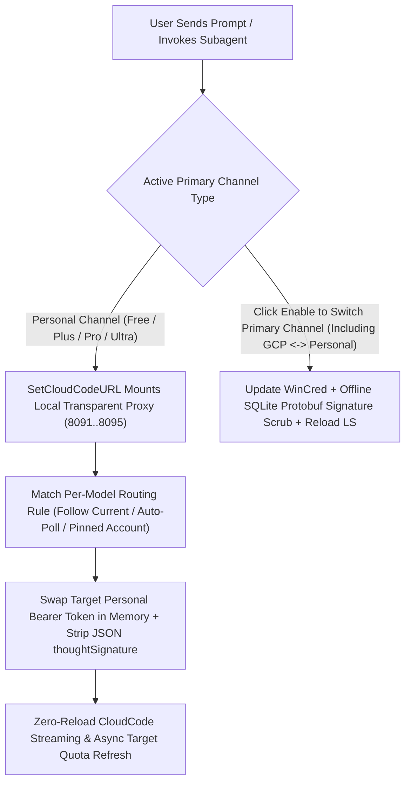

[English](README.en.md) | [简体中文](README.md)

<div align="center">
  
  <h1>Antigravity Relay</h1>
  <p>
    <b>Native Multi-Account Quota Monitor, Channel Pool & Reload-Free Model Router for Google Antigravity 2.0</b><br>
    Full-tier detection (Free / Plus / Pro / Ultra / GCP), real-time quota telemetry, zero-interruption OAuth login, and seamless cross-account model routing.
  </p>
  <p>
    <a href="https://antigravity.google/"></a>
    <a href="https://nodejs.org/"></a>
    <a href="docs/ARCHITECTURE.en.md"></a>
    <a href="LICENSE"></a>
    <a href="https://github.com/ToruOlenyeva/antigravity-relay/stargazers"></a>
  </p>
</div>

> <b>Eliminate single-account quota anxiety and cross-channel signature errors</b>: Purpose-built for <b>Google Antigravity 2.0</b>. Manage multiple personal accounts (<code>Free</code> / <code>Plus</code> / <code>Pro</code> / <code>Ultra</code>) alongside <code>GCP</code> cloud project channels, featuring real-time three-pool quota telemetry, isolated OAuth PKCE login, dual-layer <code>thoughtSignature</code> scrubbing, and zero-reload cross-account model routing.

<div align="center">
  
</div>

---

## ✨ Key Features

- <b>Full-Tier Detection & Quota Telemetry</b>: Powered by native Language Server and CloudCode probes to accurately classify <code>Free</code>, <code>Plus</code> (including promotional partner plans), <code>Pro</code>, <code>Ultra</code>, and <code>GCP</code> channels, displaying <code>Gemini Models</code>, <code>Claude and GPT Models</code>, and <code>Gemini 4 Argon</code> weekly/5-hour quota rings with live reset countdowns.
- <b>Reload-Free Personal Channel Routing</b>: Built-in local transparent reverse proxy (defaulting to port <code>8091</code> with automatic fallback across <code>8091..8095</code> and OS ephemeral ports) dynamically swaps the target personal account's <code>Bearer Token</code> per model family without reloading the UI or interrupting active chats.
- <b>Reset-First Smart Auto-Polling</b>: Configure each model to "Follow Current Channel", pin a specific personal account, or "Auto-Poll Available Channels" (prioritizing personal channels with remaining quota that reset soonest, while automatically unlocking models in the UI when the primary account hits <code>0%</code>).
- <b>Dual-Layer Thought Signature Scrubbing</b>: Combines offline SQLite Protobuf wire-format scrubbing with real-time proxy JSON signature stripping to permanently eliminate <code>Invalid thought signature (400)</code> errors when routing across accounts or switching between <code>GCP</code> and personal channels.
- <b>Zero-Interruption Isolated OAuth Login</b>: Launches the official Antigravity Google OAuth 2.0 + PKCE S256 flow on an isolated local callback port without touching live session credentials on cancel or completion, and derives new <code>GCP</code> channels directly from saved account tokens without re-login.
- <b>Non-Intrusive On-Demand GCP Discovery</b>: Clicking "Auto Scan" in the <code>GCP</code> channel drawer fetches candidate projects (auto-filling a single project or rendering a selector dropdown for multiple projects) without blindly cluttering your channel pool.
- <b>Strict Bilingual Isolation & Standalone Window</b>: Retains standard <code>Free</code> / <code>Plus</code> / <code>Pro</code> / <code>Ultra</code> / <code>GCP</code> badges across English and Chinese views with zero mixed-language leakage, dual-hosted on the dynamic Sidecar port and fixed port <code>8089</code> with real-time SSE sync.

---

## 🔄 Core Workflow



---

## 🚀 Quick Installation

Built with native Node.js and <b>Zero Dependencies</b>. Clone and run immediately without executing <code>npm install</code>.

### 1. Clone into Antigravity Plugins Directory

<b>macOS / Linux</b>:
```bash
git clone https://github.com/ToruOlenyeva/antigravity-relay.git ~/.gemini/config/plugins/antigravity-relay
```

<b>Windows (PowerShell)</b>:
```powershell
git clone https://github.com/ToruOlenyeva/antigravity-relay.git "$env:USERPROFILE\.gemini\config\plugins\antigravity-relay"
```

<b>Windows (CMD)</b>:
```cmd
git clone https://github.com/ToruOlenyeva/antigravity-relay.git %USERPROFILE%\.gemini\config\plugins\antigravity-relay
```

### 2. Enable and Launch

Restart Google Antigravity or enable "Account & Quota Manager" in the Antigravity Plugins settings tab to open the panel in the right Auxiliary Pane.

---

## 📂 Modular Project Structure

```
antigravity-relay/
├── assets/                      # Brand vector logo and bilingual HD previews
├── docs/                        # Deep technical architecture documentation
├── skills/                      # Domain engineering skill specifications
│   ├── account-and-hotswap/     # Isolated OAuth, WinCred swap, and proxy routing spec
│   └── quota-and-ledger/        # Three-pool quota probes and tier filtering spec
├── sidecars/
│   └── panel/                   # Native build-free decoupled Sidecar panel
│       ├── app.js               # Frontend interaction, custom dropdowns, and sync engine
│       ├── i18n.js              # Strictly isolated English and Chinese dictionary
│       ├── index.html           # Responsive frontend HTML skeleton
│       ├── ls-bridge.mjs        # Backend LS RPC, transparent proxy, WinCred & OAuth engine
│       ├── main.mjs             # Backend dual-port HTTP router and SSE broadcaster
│       ├── preload.js           # Host preload bridge script
│       ├── sidecar.json         # Sidecar container manifest
│       ├── store.mjs            # Atomic config persistence and legacy model sanitizer
│       └── styles.css           # Flat adaptive dark and light theme stylesheet
├── agy-relay-config.example.json # Sanitized example configuration file
├── hooks.json                   # Antigravity lifecycle Hook manifest
├── open-panel.bat               # Standalone window quick launcher script
├── plugin.json                  # Plugin public manifest
├── relay-hook.cjs               # Pre-invocation routing guard and Sidecar self-healer
├── README.en.md                 # English documentation
└── README.md                    # Chinese documentation
```

---

## 📖 Usage Guide

### 1. Real-Time Quota Monitoring & Full-Tier Detection
Open the "Account & Quota" tab in the right Auxiliary Pane:
- The top "Session & Usage" selector tracks the active primary channel by default (marked with a green dot) and lets you inspect any saved channel's live quota rings and reset countdowns.
- Each channel is automatically badged as <code>Free</code>, <code>Plus</code>, <code>Pro</code>, <code>Ultra</code>, or <code>GCP</code> based on its true available model matrix, filtering out unavailable or deprecated models.

### 2. Independent Channel Pool & Zero-Interruption OAuth
- <b>Save Current</b>: Captures the currently logged-in host credential and creates the corresponding personal or <code>GCP</code> channel card.
- <b>+ Add Account</b>: Opens the official Google OAuth login page in your browser on an isolated callback port without interrupting running conversations.
- <b>+ Add Channel</b>: Derives a personal channel or <code>GCP</code> cloud project channel directly from any saved account; clicking "Auto Scan" in <code>GCP</code> mode populates candidate project IDs for selection, and clicking "Enable" on any card reloads the primary host session into that channel.

### 3. Reload-Free Personal Model Routing & Auto-Polling
- The bottom "Model Compute Routing" section aggregates all available models across your personal channels (<code>Free</code> / <code>Plus</code> / <code>Pro</code> / <code>Ultra</code>), keeping <code>GCP</code> channels completely independent.
- Assign any model to "Auto-Poll Available Channels" or a specific personal account to transparently route foreground prompts and subagent calls through the local proxy without reloading the window.

### 4. Standalone Window Mode
When working with the Auxiliary Pane collapsed, double-click <code>open-panel.bat</code> or visit <code>http://127.0.0.1:8089</code> in any modern browser to monitor quotas and manage routing in a standalone app window.

---

## 📚 Documentation Matrix

| Module | Description & Technical Details | Link |
| :--- | :--- | :--- |
| <b>System Architecture</b> | Full-tier detection matrix, reload-free transparent proxy, port fallback, dual-layer signature scrubbing, and API specs | [View Architecture](docs/ARCHITECTURE.en.md) |
| <b>Example Configuration</b> | Sanitized JSON template demonstrating multi-tier personal channels, GCP channels, and model routing rules | [View Example Config](agy-relay-config.example.json) |

---

## 🤝 Contributors & Credits

- <b>[Toru Olenyeva](https://github.com/ToruOlenyeva)</b>
- <b>[Google Antigravity](https://antigravity.google/)</b>

---

## 📄 License

This project is licensed under the [<b>MIT License</b>](LICENSE).
