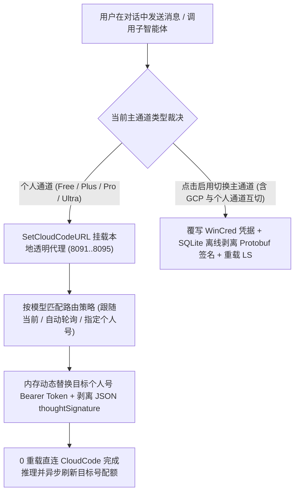

[English](README.en.md) | [简体中文](README.md)

<div align="center">
  
  <h1>Antigravity Relay</h1>
  <p>
    <b>Google Antigravity 2.0 原生多账号配额监控、独立通道池与免重载算力路由中心</b><br>
    全等级（Free / Plus / Pro / Ultra / GCP）精准识别、三大配额池实时监控、旁路零打断登录与跨个人账号无感算力接力。
  </p>
  <p>
    <a href="https://antigravity.google/"></a>
    <a href="https://nodejs.org/"></a>
    <a href="docs/ARCHITECTURE.md"></a>
    <a href="LICENSE"></a>
    <a href="https://github.com/ToruOlenyeva/antigravity-relay/stargazers"></a>
  </p>
</div>

> <b>告别单账号配额焦虑与跨通道切换报错</b>：专为 <b>Google Antigravity 2.0</b> 打造的多账号池与算力路由插件。支持同一客户端内管理多个个人账号（<code>Free</code> / <code>Plus</code> / <code>Pro</code> / <code>Ultra</code>）与 <code>GCP</code> 云项目通道，提供三大官方配额池实时探针、旁路零打断 OAuth 授权登录、双层思维签名（<code>thoughtSignature</code>）无损剥离以及个人通道间 0 重载无感算力路由。

<div align="center">
  
</div>

---

## ✨ 核心特性

- <b>全等级精准识别与配额透视</b>：基于底层 Language Server 与 CloudCode 原生探针，精准区分 <code>Free</code>（无会员）、<code>Plus</code>（含渠道赠送版）、<code>Pro</code>、<code>Ultra</code> 与 <code>GCP</code> 五大通道等级，1:1 还原 <code>Gemini 模型</code>、<code>Claude 和 GPT 模型</code> 及 <code>Gemini 4 Argon</code> 独立周限额三大配额池与重置倒计时。
- <b>个人通道免重载无感路由</b>：内置本地透明反向代理（默认 <code>8091</code> 端口，支持 <code>8091..8095</code> 及随机端口自动递增防冲突回退），按模型家族实时替换目标个人账号 <code>Bearer Token</code>，对话全程 0 界面重载、0 中断。
- <b>按重置时间智能自动轮询</b>：每个模型支持设置「跟随当前通道」、「指定个人账号通道」或「自动轮询有余额通道」（优先消耗最早重置且有剩余额度的个人账号，并在主账号 <code>0%</code> 时自动解除前端模型灰显锁死）。
- <b>双层思维签名识别与双模式无损剥离</b>：实时识别并展示当前会话及历史会话的签名归属徽章（<code>GCP</code> / <code>个人</code> / <code>无签名</code>），卡片右上角提供「仅清除当前会话签名」与「全项目扫描清除跨通道不匹配签名」双模式一键清理，结合透明代理流式剥离彻底根除 <code>Invalid thought signature (400)</code> 报错。
- <b>会话统计与项目汇总一键切换</b>：直读官方 <code>transcript.jsonl</code> 原生 Token 账单，支持在卡片内一键按钮切换「当前会话统计」（支持下拉切换项目内任意历史会话）与「项目汇总」（统计当前项目全部会话累计用词、缓存命中率与按模型细分用量）。
- <b>独立多开实例、四重登录态同步与双通道互锁</b>：支持 <code>+ 多开实例</code> 一键拉起独立用户目录的个人或 <code>GCP</code> 实例（当个人与 <code>GCP</code> 双通道实例同时在场时自动互锁防串扰）；跨通道切换内置 Antigravity 2.29+ 四重登录态同步（<code>WinCred</code> + <code>state.vscdb</code> Protobuf Sentinel + <code>app_storage.json</code> + <code>auth_method</code> 隔离）与单实例无感自重启。
- <b>旁路零打断官方 OAuth 登录与非侵入式 GCP 扫描</b>：通过独立本地随机端口拉起官方 Google OAuth 2.0 + PKCE S256 授权流程，支持免重登直接派生 <code>GCP</code> 通道并按需扫描点选云项目编号，同时监听宿主动态端口与固定 <code>8089</code> 端口。

---

## 🔄 核心工作流原理



---

## 🚀 快速安装

本项目采用纯原生 Node.js 构建，<b>零外部依赖（Zero Dependencies）</b>，克隆即可运行，无需执行 <code>npm install</code>。

### 1. 克隆插件至 Antigravity 插件目录

<b>macOS / Linux</b>:
```bash
git clone https://github.com/ToruOlenyeva/antigravity-relay.git ~/.gemini/config/plugins/antigravity-relay
```

<b>Windows (PowerShell)</b>:
```powershell
git clone https://github.com/ToruOlenyeva/antigravity-relay.git "$env:USERPROFILE\.gemini\config\plugins\antigravity-relay"
```

<b>Windows (CMD)</b>:
```cmd
git clone https://github.com/ToruOlenyeva/antigravity-relay.git %USERPROFILE%\.gemini\config\plugins\antigravity-relay
```

### 2. 生效与启动

克隆完成后，重启 Google Antigravity 或在插件设置列表中开启「账号与配额管理」即可在右侧辅助栏使用。

---

## 📂 模块化目录结构

```
antigravity-relay/
├── assets/                      # 品牌矢量图标与双语高清预览图
├── docs/                        # 深度技术架构设计文档
├── lib/
│   └── proto-scrub.cjs          # Protobuf 跨通道思考签名离线剥离引擎
├── sidecars/
│   └── panel/                   # 原生免构建前后端分离 Sidecar 面板
│       ├── app.js               # 前端核心交互、自定义下拉与状态同步引擎
│       ├── i18n.js              # 前端中英双语严格隔离词典
│       ├── index.html           # 前端响应式骨架页面
│       ├── ls-bridge.mjs        # 后端 LS RPC、透明代理、WinCred 与 OAuth 引擎
│       ├── main.mjs             # 后端双端口 HTTP 路由与 SSE 实时广播入口
│       ├── preload.js           # 宿主预加载桥接脚本
│       ├── sidecar.json         # Sidecar 容器清单契约
│       ├── store.mjs            # 配置原子化落盘与历史脏数据清洗引擎
│       └── styles.css           # 纯扁平深浅色自适应主题样式表
├── agy-relay-config.example.json # 脱敏示例配置档案
├── hooks.json                   # Antigravity 生命周期 Hook 契约
├── open-panel.bat               # 独立小窗模式快速启动脚本
├── plugin.json                  # 插件公开元数据契约
├── relay-hook.cjs               # 会话前置路由守护与 Sidecar 自愈钩子
├── README.en.md                 # 英文说明文档
└── README.md                    # 中文说明文档
```

---

## 📖 使用方法指南

### 1. 实时配额监控、会话/项目统计切换与双模式清签名
在 Antigravity 右侧辅助栏打开「账号与配额管理」面板：
- 顶部「会话与使用量」下拉框默认跟随当前实例激活通道（带绿色圆点标记），也可随时点选任意已收录通道预览其最新配额与重置倒计时；系统自动标定 <code>Free</code>、<code>Plus</code>、<code>Pro</code>、<code>Ultra</code> 与 <code>GCP</code> 方形彩色徽章。
- 「当前会话统计 / 项目汇总」卡片支持点击标题旁按钮一键切换「会话统计」（可下拉查看项目内任意会话并显示 <code>签名: GCP</code> / <code>签名: 个人</code> / <code>签名: 无签名</code> 徽章）与「项目汇总」，右上角「清除签名」按钮提供「仅清除当前会话签名」与「全项目扫描清除不匹配签名」双模式菜单。

### 2. 独立通道池、四重登录态同步与独立多开实例
- <b>收录当前 / + 添加账号</b>：一键收录当前已登录凭据，或在浏览器拉起官方旁路 OAuth 登录添加新 Google 账号（授权全程零打断当前对话）。
- <b>+ 添加通道与四重同步切换</b>：直接复用池内已有账号凭据派生个人或 <code>GCP</code> 通道（支持「自动扫描」点选云项目编号）；点击通道卡片「启用」时自动执行四重登录态同步并在跨通道切换时自动重启当前实例。
- <b>+ 多开实例与双通道互锁</b>：点击 <code>+ 多开实例</code> 可在独立用户目录下拉起第二个实例（个人实例与 <code>GCP</code> 实例双开并存时自动锁定跨通道切换并隐藏不可切换项按钮，防止同通道配置冲突）。

### 3. 个人通道免重载算力路由与自动轮询
- 底部「模型算力路由」自动汇总池内所有个人通道（<code>Free</code> / <code>Plus</code> / <code>Pro</code> / <code>Ultra</code>）支持的可用模型合集（<code>GCP</code> 通道完全独立不参与底部路由）。
- 为任意模型选择「自动轮询有余额通道」或指定某个有额度的个人通道后，前台对话与后台子智能体调用该模型时将通过本地透明代理自动扣除目标个人账号配额，无需重载主界面。

### 4. 独立小窗模式
若未展开右侧辅助栏，可双击插件目录下的 <code>open-panel.bat</code> 或在浏览器访问 <code>http://127.0.0.1:8089</code>，通过独立桌面小窗实时监控配额与调整路由。

---

## 📚 官方技术文档中心

| 模块名称 | 说明与技术细节 | 链接 |
| :--- | :--- | :--- |
| <b>系统架构设计</b> | 全等级探测矩阵、本地透明代理免重载路由、端口回退、双层签名剥离与 API 规范 | [查看架构文档](docs/ARCHITECTURE.md) |
| <b>示例配置档案</b> | 包含多等级个人通道、GCP 通道与模型路由策略的标准脱敏 JSON 模板 | [查看示例配置](agy-relay-config.example.json) |

---

## 🤝 贡献与共创团队

- <b>[Toru Olenyeva](https://github.com/ToruOlenyeva)</b>
- <b>[Google Antigravity](https://antigravity.google/)</b>

---

## 📄 开源协议

本项目基于 [<b>MIT License</b>](LICENSE) 开源。
