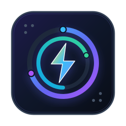
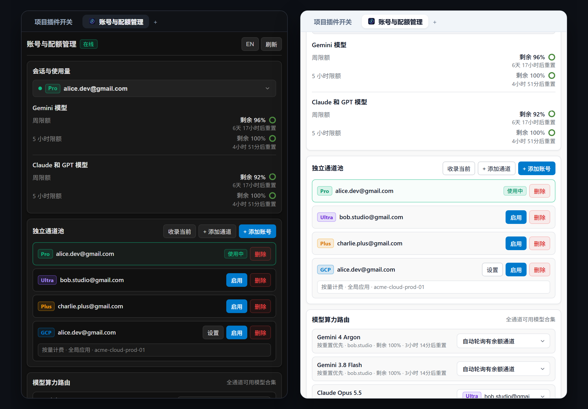
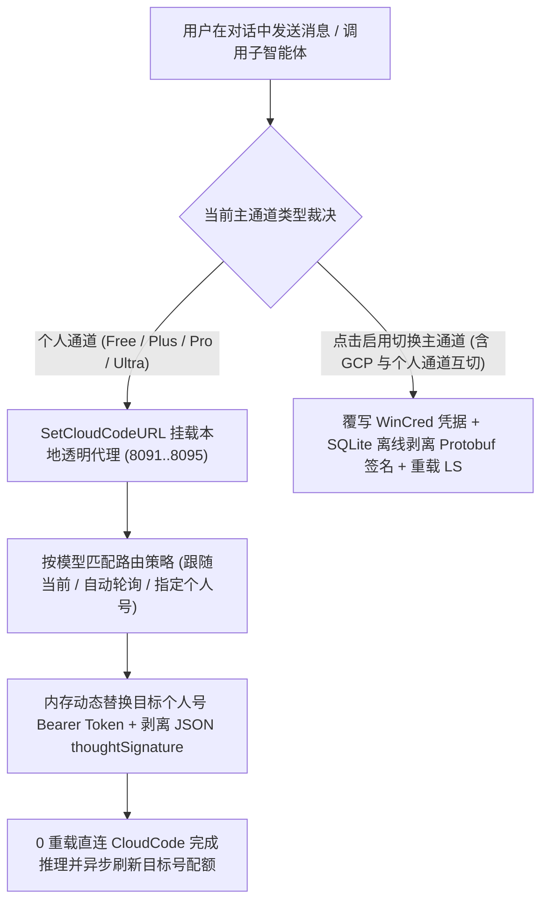

[English](README.en.md) | [简体中文](README.md)

<div align="center">
  
  <h1>Antigravity Relay</h1>
  <p>
    <b>Google Antigravity 2.0 原生多账号配额监控、独立通道池与免重载算力路由中心</b><br>
    全等级（Free / Plus / Pro / Ultra / GCP）精准识别、三大配额池实时监控、旁路零打断登录与跨个人账号无感算力接力。
  </p>
  <p>
    <a href="https://antigravity.google/"></a>
    <a href="https://nodejs.org/"></a>
    <a href="docs/ARCHITECTURE.md"></a>
    <a href="LICENSE"></a>
    <a href="https://github.com/ToruOlenyeva/antigravity-relay/stargazers"></a>
  </p>
</div>

> <b>告别单账号配额焦虑与跨通道切换报错</b>：专为 <b>Google Antigravity 2.0</b> 打造的多账号池与算力路由插件。支持同一客户端内管理多个个人账号（<code>Free</code> / <code>Plus</code> / <code>Pro</code> / <code>Ultra</code>）与 <code>GCP</code> 云项目通道，提供三大官方配额池实时探针、旁路零打断 OAuth 授权登录、双层思维签名（<code>thoughtSignature</code>）无损剥离以及个人通道间 0 重载无感算力路由。

<div align="center">
  
</div>

---

## ✨ 核心特性

- <b>全等级精准识别与配额透视</b>：基于底层 Language Server 与 CloudCode 原生探针，精准区分 <code>Free</code>（无会员）、<code>Plus</code>（含渠道赠送版）、<code>Pro</code>、<code>Ultra</code> 与 <code>GCP</code> 五大通道等级，1:1 还原 <code>Gemini 模型</code>、<code>Claude 和 GPT 模型</code> 及 <code>Gemini 4 Argon</code> 独立周限额三大配额池与重置倒计时。
- <b>个人通道免重载无感路由</b>：内置本地透明反向代理（默认 <code>8091</code> 端口，支持 <code>8091..8095</code> 及随机端口自动递增防冲突回退），按模型家族实时替换目标个人账号 <code>Bearer Token</code>，对话全程 0 界面重载、0 中断。
- <b>按重置时间智能自动轮询</b>：每个模型支持设置「跟随当前通道」、「指定个人账号通道」或「自动轮询有余额通道」（优先消耗最早重置且有剩余额度的个人账号，并在主账号 <code>0%</code> 时自动解除前端模型灰显锁死）。
- <b>双层思维签名无损剥离</b>：独创 SQLite 离线 Protobuf 签名剥离 + 透明代理 JSON 流式签名剥离双引擎，彻底根除跨账号路由或 <code>GCP</code> 与个人通道相互切换后继续旧对话触发的 <code>Invalid thought signature (400)</code> 崩溃。
- <b>旁路零打断官方 OAuth 登录</b>：通过独立本地随机端口拉起 Antigravity 官方 Google OAuth 2.0 + PKCE S256 授权流程，无论授权成功或中途取消均不触碰当前在线会话凭据，支持免重登直接复用已有账号凭据派生 <code>GCP</code> 通道。
- <b>非侵入式 GCP 项目按需扫描</b>：添加 <code>GCP</code> 通道时点击「自动扫描」仅拉取可用云项目候选列表（单项目直接填入、多项目提供下拉框点选填入），绝不擅自批量建卡污染通道池。
- <b>双语纯净隔离与独立小窗托管</b>：中英文界面保留 <code>Free</code> / <code>Plus</code> / <code>Pro</code> / <code>Ultra</code> / <code>GCP</code> 标准徽章且零语种混杂，同时监听宿主动态端口与固定 <code>8089</code> 端口，支持 SSE 零延迟同步与独立小窗操控。

---

## 🔄 核心工作流原理



---

## 🚀 快速安装

本项目采用纯原生 Node.js 构建，<b>零外部依赖（Zero Dependencies）</b>，克隆即可运行，无需执行 <code>npm install</code>。

### 1. 克隆插件至 Antigravity 插件目录

<b>macOS / Linux</b>:
```bash
git clone https://github.com/ToruOlenyeva/antigravity-relay.git ~/.gemini/config/plugins/antigravity-relay
```

<b>Windows (PowerShell)</b>:
```powershell
git clone https://github.com/ToruOlenyeva/antigravity-relay.git "$env:USERPROFILE\.gemini\config\plugins\antigravity-relay"
```

<b>Windows (CMD)</b>:
```cmd
git clone https://github.com/ToruOlenyeva/antigravity-relay.git %USERPROFILE%\.gemini\config\plugins\antigravity-relay
```

### 2. 生效与启动

克隆完成后，重启 Google Antigravity 或在插件设置列表中开启「账号与配额管理」即可在右侧辅助栏使用。

---

## 📂 模块化目录结构

```
antigravity-relay/
├── assets/                      # 品牌矢量图标与双语高清预览图
├── docs/                        # 深度技术架构设计文档
├── skills/                      # 插件工程领域技能规范
│   ├── account-and-hotswap/     # 旁路 OAuth、凭据切换与透明代理路由契约
│   └── quota-and-ledger/        # 三大配额池探针与全等级模型过滤契约
├── sidecars/
│   └── panel/                   # 原生免构建前后端分离 Sidecar 面板
│       ├── app.js               # 前端核心交互、自定义下拉与状态同步引擎
│       ├── i18n.js              # 前端中英双语严格隔离词典
│       ├── index.html           # 前端响应式骨架页面
│       ├── ls-bridge.mjs        # 后端 LS RPC、透明代理、WinCred 与 OAuth 引擎
│       ├── main.mjs             # 后端双端口 HTTP 路由与 SSE 实时广播入口
│       ├── preload.js           # 宿主预加载桥接脚本
│       ├── sidecar.json         # Sidecar 容器清单契约
│       ├── store.mjs            # 配置原子化落盘与历史脏数据清洗引擎
│       └── styles.css           # 纯扁平深浅色自适应主题样式表
├── agy-relay-config.example.json # 脱敏示例配置档案
├── hooks.json                   # Antigravity 生命周期 Hook 契约
├── open-panel.bat               # 独立小窗模式快速启动脚本
├── plugin.json                  # 插件公开元数据契约
├── relay-hook.cjs               # 会话前置路由守护与 Sidecar 自愈钩子
├── README.en.md                 # 英文说明文档
└── README.md                    # 中文说明文档
```

---

## 📖 使用方法指南

### 1. 实时配额监控与全等级识别
在 Antigravity 右侧辅助栏打开「账号与配额管理」面板：
- 顶部「会话与使用量」下拉框默认跟随当前主界面激活通道（带绿色圆点标记），也可随时点选任意已收录通道预览其最新配额与重置倒计时。
- 系统自动按各账号真实可用模型矩阵标定 <code>Free</code>、<code>Plus</code>、<code>Pro</code>、<code>Ultra</code> 与 <code>GCP</code> 方形彩色徽章，自动剔除不可用或即将下线的模型。

### 2. 独立通道池与旁路零打断登录
- <b>收录当前</b>：一键读取当前客户端已登录凭据并建立对应个人通道或 <code>GCP</code> 通道卡片。
- <b>+ 添加账号</b>：在浏览器拉起官方登录页添加新 Google 账号，授权全程零打断当前正在进行的 AI 对话。
- <b>+ 添加通道</b>：直接复用池内已有 Google 账号凭据派生个人通道或 <code>GCP</code> 云项目通道；<code>GCP</code> 模式下点击「自动扫描」可点选填入目标项目编号，点击通道卡片上的「启用」即可重载切换主界面账号。

### 3. 个人通道免重载算力路由与自动轮询
- 底部「模型算力路由」自动汇总池内所有个人通道（<code>Free</code> / <code>Plus</code> / <code>Pro</code> / <code>Ultra</code>）支持的可用模型合集（<code>GCP</code> 通道完全独立不参与底部路由）。
- 为任意模型选择「自动轮询有余额通道」或指定某个有额度的个人通道后，前台对话与后台子智能体调用该模型时将通过本地透明代理自动扣除目标个人账号配额，无需重载主界面。

### 4. 独立小窗模式
若未展开右侧辅助栏，可双击插件目录下的 <code>open-panel.bat</code> 或在浏览器访问 <code>http://127.0.0.1:8089</code>，通过独立桌面小窗实时监控配额与调整路由。

---

## 📚 官方技术文档中心

| 模块名称 | 说明与技术细节 | 链接 |
| :--- | :--- | :--- |
| <b>系统架构设计</b> | 全等级探测矩阵、本地透明代理免重载路由、端口回退、双层签名剥离与 API 规范 | [查看架构文档](docs/ARCHITECTURE.md) |
| <b>示例配置档案</b> | 包含多等级个人通道、GCP 通道与模型路由策略的标准脱敏 JSON 模板 | [查看示例配置](agy-relay-config.example.json) |

---

## 🤝 贡献与共创团队

- <b>[Toru Olenyeva](https://github.com/ToruOlenyeva)</b>
- <b>[Google Antigravity](https://antigravity.google/)</b>

---

## 📄 开源协议

本项目基于 [<b>MIT License</b>](LICENSE) 开源。
